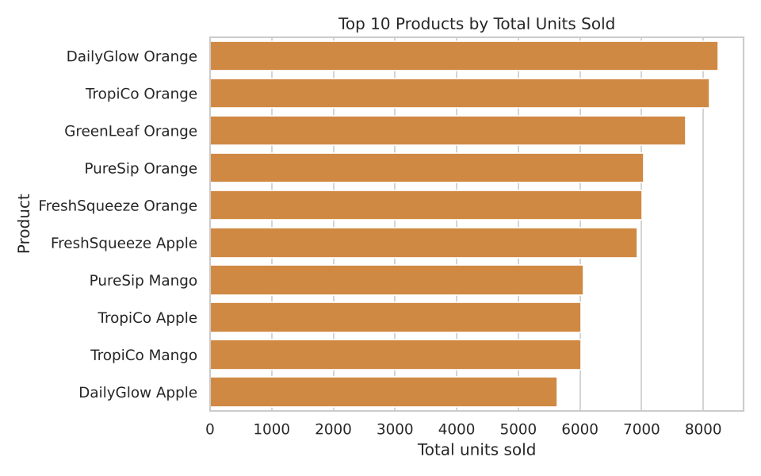
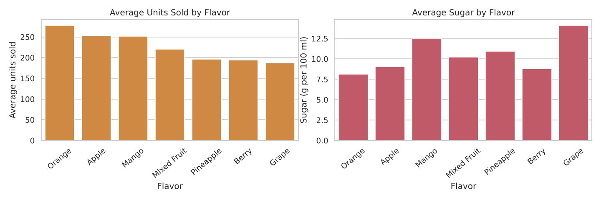
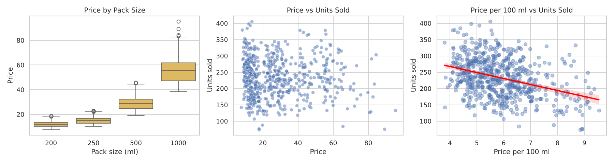
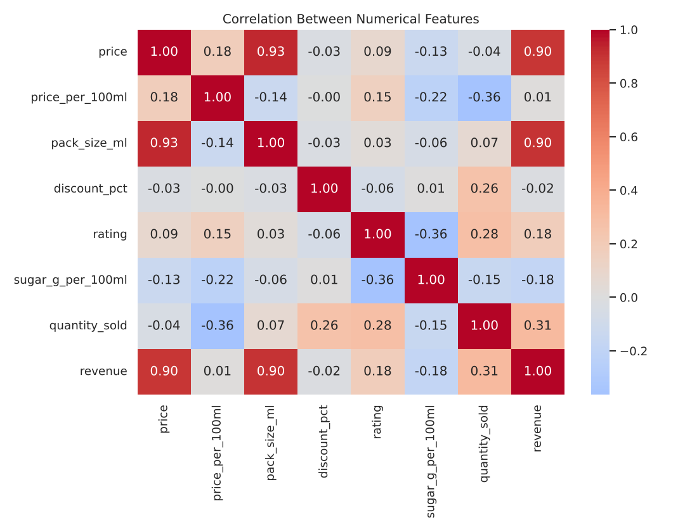

# Juice Dataset Analysis & Machine Learning

A beginner-level data science project: cleaning a juice sales dataset, exploring it with charts, and predicting units sold with Linear Regression.

> **Important:** the dataset is **simulated**, not real store or Kaggle data. I generated it with `src/generate_dataset.py` and deliberately added missing values, duplicates, typos and inconsistent labels so the cleaning steps are realistic. Because I defined the rules that create the data, the patterns in it are not findings about the real juice market. The project demonstrates the workflow, not market insights.

## Overview
Pipeline: load data, clean it, explore it, prepare features, train one model, evaluate it honestly.

## Objectives
- Practice cleaning messy tabular data with Pandas
- Answer simple questions about sales with EDA and visualisation
- Build and evaluate a regression model with Scikit-learn

## Dataset Information
665 rows and 12 columns: `product_name`, `category` (flavor), `pack_size_ml`, `price`, `discount_pct`, `quantity_sold`, `rating`, `sugar_g_per_100ml`, `is_organic`, `month`, `region`, `revenue`. Target: `quantity_sold`.

## Technologies Used
Python, Pandas, NumPy, Matplotlib, Seaborn, Scikit-learn, Jupyter Notebook

## Data Cleaning
- Standardised inconsistent text (`ORANGE`, ` Orange `) and converted `is_organic` to boolean
- Removed 15 duplicate rows
- Set impossible ratings (outside 1-5) and 4 price typos to missing
- Dropped 10 rows with missing or negative `quantity_sold` (the target)
- Filled missing price, rating and sugar with group medians
- Recomputed `revenue` from price, discount and quantity

Result: 665 rows became 640, with no missing values.

## Exploratory Data Analysis
| | |
|---|---|
|  |  |
|  |  |

## Machine Learning Approach
- **Model:** Linear Regression
- **Target:** `quantity_sold`
- **Features:** price per 100 ml (engineered), pack size, discount, rating, sugar, organic flag, summer flag, flavor (one-hot encoded)
- **Excluded:** `revenue` (it is calculated from the target, so using it would be data leakage), `product_name`, `region`, `month`
- 80/20 train-test split with `random_state=42`; numeric features standardised using training data only

## Model Evaluation (test set, 128 rows)
| Metric | Value |
|---|---|
| MAE | 25.91 |
| MSE | 1094.26 |
| RMSE | 33.08 |
| R² | 0.681 |

Average units sold in the test set is about 231. The model explains roughly two thirds of the variation, a reasonable first result but not highly accurate.

## Key Findings (for this simulated dataset)
- Flavor strongly affects sales: Orange is highest, Grape, Berry and Pineapple are lowest
- Raw price barely relates to sales (it mostly reflects bottle size), but price per 100 ml has a clear negative relationship
- Sales are higher from May to August
- Organic products sold fewer units on average
- Region has almost no effect

## Conclusion
The workflow works end to end and the model gives a sensible baseline. Limits: simulated data, a single train-test split, and a linear model that can't capture complex patterns.

## Future Improvements
- Repeat the project on a real dataset
- Add cross-validation
- Compare with Random Forest
- Test whether interactions (e.g. flavor x season) improve results

## Project Structure
```
juice-dataset-analysis/
├── data/juice_dataset.csv
├── images/                  (charts saved from the notebook)
├── notebooks/juice_analysis.ipynb
├── src/
│   ├── analysis.py          (cleaning + model code)
│   └── generate_dataset.py  (creates the simulated CSV)
├── requirements.txt
└── README.md
```

## How to Run
```bash
pip install -r requirements.txt
jupyter notebook notebooks/juice_analysis.ipynb   # run all cells
python src/analysis.py                            # prints cleaning + metrics
python src/generate_dataset.py                    # optional: regenerate the data
```
